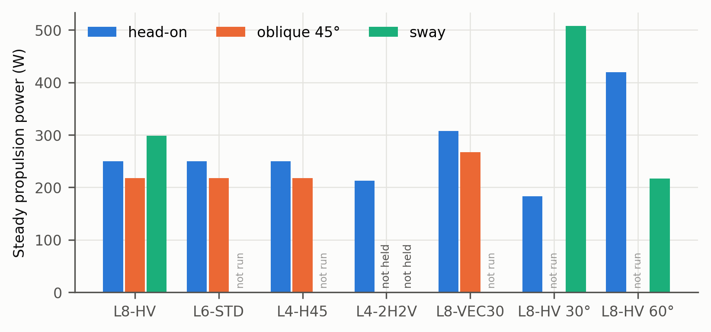
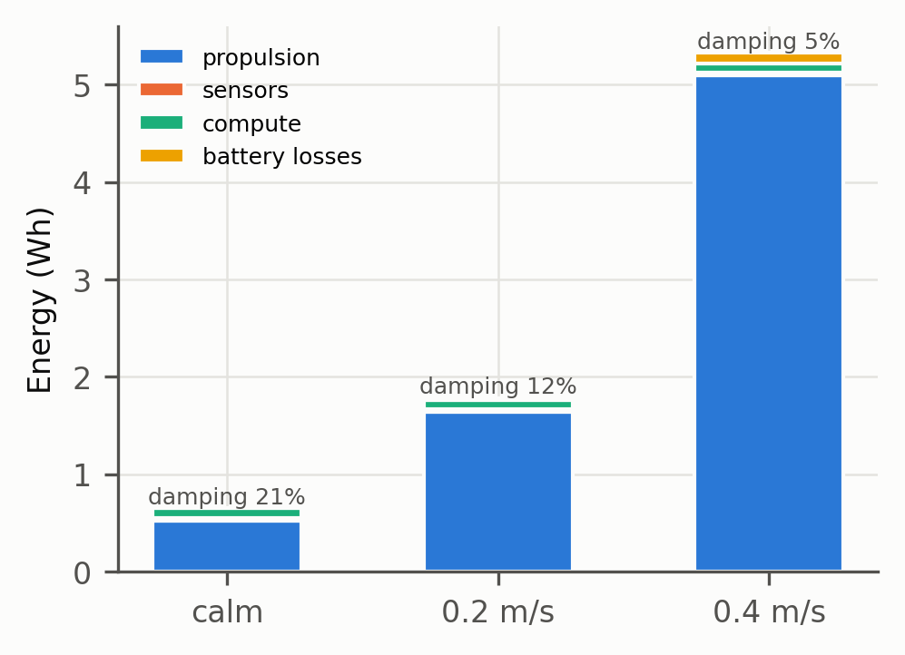
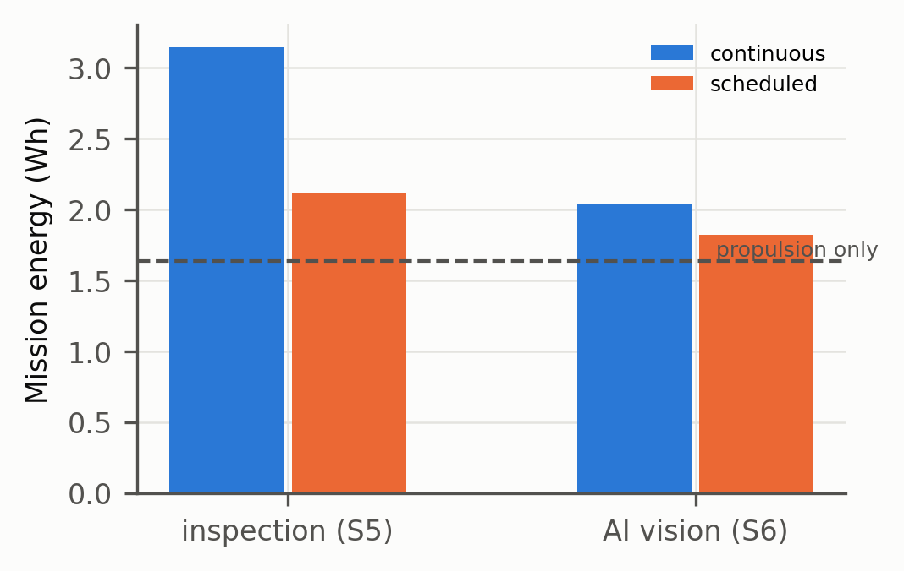
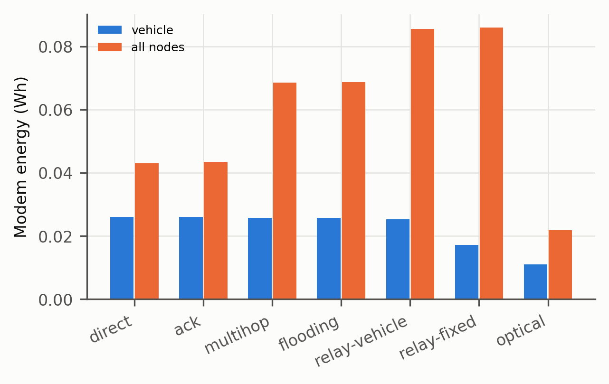
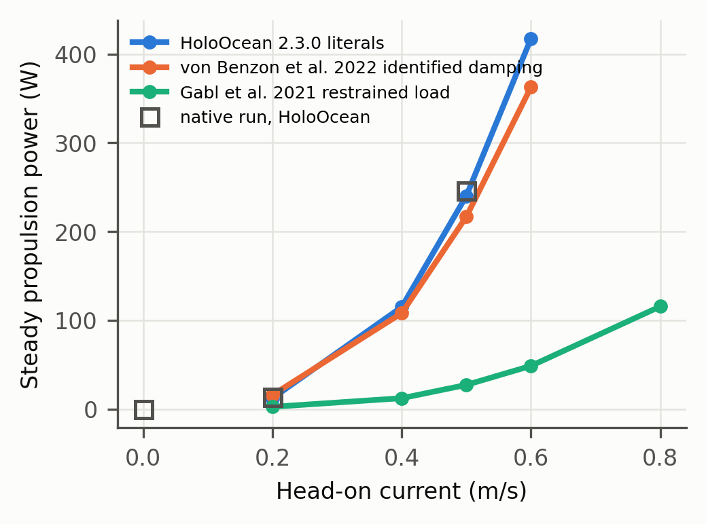
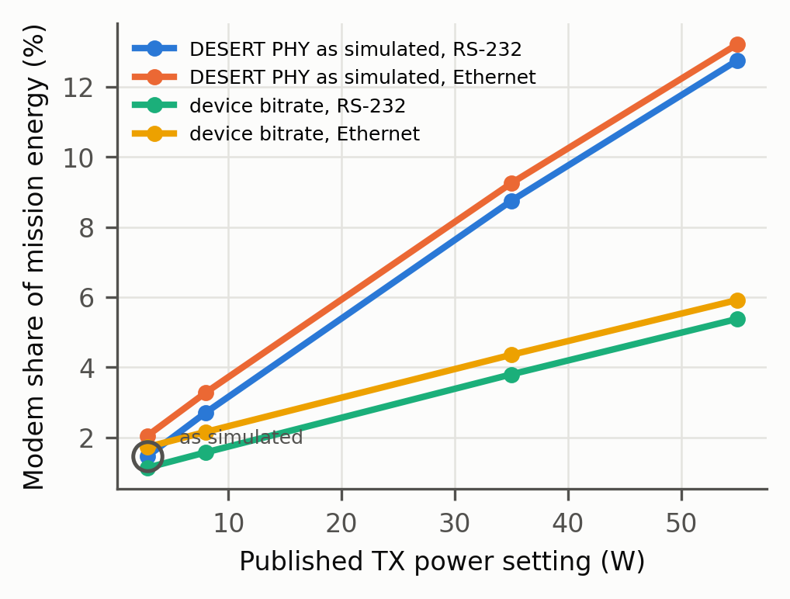

# Evidence-traceable mission-energy modelling of configurable marine robots: parameter-level provenance, simulator coupling and verification

*Draft for Simulation Modelling Practice and Theory, not submitted. Bracketed identifiers [C1] to
[C29] refer to the claims of `docs/paper/CLAIM_EVIDENCE_MATRIX.md`. Every number and every
empirical statement is bound to one of them and holds only under the conditions stated there. The
results are in `experiments/results/final/`.*

## Abstract

Simulated mission energy for marine robots combines thruster maps, component powers, battery
parameters and hydrodynamic loads whose evidence ranges from exact manufacturer data to placeholders,
yet a reported estimate rarely shows which of these it rests on. This paper presents a simulation
methodology for evidence-traceable mission-energy estimates within explicitly stated model
assumptions and evidence bounds. The energy model of a configurable robot is composed from actuators,
components, converters and a battery. Each parameter is linked to an evidence record whose grade is
capped by its relation to the modelled device, and electrical-model evidence is reported apart from
the evidence for the dynamics. Published ranges are propagated to intervals whose unsupported sides
stay open, and decision rules return supported, unsupported or indeterminate verdicts. The method is
implemented with HoloOcean as the dynamics backend and DESERT network activity on the same electrical
bus. The accounting closes with a worst relative error of 1.9e-13 over 36 runs [C2], and a backend
check separates a drag-patched HoloOcean 2.3.0 build from the unpatched one, which applies 0.01 of the
declared drag [C1]. On a simulated BlueROV2 Heavy inspection mission, the nominal values rank one
imaging sonar below another, but the published ranges do not support that ranking, and no payload
configuration can be certified for any tested leg target [C23]. Model structures reproduced from two
existing approaches, calibrated on calm water, cannot represent the effect of current on propulsion
[C27], and published
BlueROV2 resistance data scale station-keeping propulsion by 0.11–0.22 or 0.87–1.29 [C12]. Physical
validation is absent: no estimate in this paper has been compared with measured mission energy
[C28].

**Keywords:** mission energy; marine robots; evidence provenance; simulation verification; interval
bounds; underwater communication; HoloOcean

## 1 Introduction

Energy limits the endurance, payload and communication budget of small marine robots. Thruster
layouts, payload schedules and communication strategies are compared in simulation before field
trials, usually through a mission energy. That number integrates modelled powers whose evidence
differs in kind. Thruster tables are measured under bollard conditions and applied in inflow; sensor
powers are datasheet maxima; modem receive powers are stated as "less than" a value; battery curves
lack a measured source; and hydrodynamic coefficients belong to the simulator rather than to the
vehicle.

A single estimate hides these differences. It does not show how much of the energy rests on proxies,
maxima or placeholders, whether a comparison survives the published ranges of its inputs, or whether
a requirement such as a number of inspection legs per charge is met, violated or undecidable.
Credibility assessments rate a model or study as a whole (Blattnig et al., 2008), and the energy
models of current robot simulators carry their parameters without per-parameter sources (Section 2).

This paper proposes a simulation methodology for evidence-traceable mission-energy estimates within
explicitly stated model assumptions and evidence bounds. It is neither a validated vehicle model nor
a battery add-on for one simulator. The method composes the energy model of a configurable robot from
components, links each parameter to evidence, keeps electrical and dynamics evidence apart,
propagates published bounds without filling unsupported sides, and states which decisions the
evidence supports. The implementation, HoloEnergy, uses HoloOcean (Potokar et al., 2022) as the
dynamics backend and DESERT Underwater (Toso and Favaro, 2017) as the network simulator, with a
simulated BlueROV2 Heavy as the reference case.

The study addresses six research questions:
- **RQ1.** Can the mission energy of a configurable robot be accounted for in a numerically closed
  way, with every energy recomputable from the power trace and every parameter traceable to a record?
- **RQ2.** How do actuator geometry and the environment influence simulator-derived estimates, and
  which effects are properties of the simulated body?
- **RQ3.** What do sensing, computing and communications contribute, and how do scheduling and
  communication strategy change this?
- **RQ4.** Can parameter-level provenance identify when a decision is supported, unsupported or
  indeterminate?
- **RQ5.** How do the estimates, and the information that accompanies them, differ from those of
  simpler or existing approaches?
- **RQ6.** Which conclusions remain robust under alternative defensible physical and electrical
  evidence?

Real-world predictive accuracy is not among them: no measured mission energy of the reference vehicle
was available, and no suitable public dataset was found [C28].

The contributions are:
1. generic composition of a configurable robot's energy model (Sections 3, 4) [C21];
2. parameter-level evidence records with grades capped by relation (Section 5) [C3, C4];
3. separate reporting of electrical-model and dynamics evidence (Section 5.4) [C22];
4. mission-level accounting with closure identities (Section 3) [C2];
5. dynamic coupling with the simulator through voltage-dependent thrust bounds, power limiting and
   wrench-equivalent virtual layouts (Sections 4, 6) [C16];
6. network physical-layer events integrated as modem power states on the vehicle bus (Section 6)
   [C17, C18];
7. propagation of published ranges and upper bounds with open sides (Sections 5, 12) [C29];
8. evidence-aware decision rules for requirements and rankings (Section 10) [C23, C24, C25];
9. a verification and validation (V&V) workflow that classifies each activity and checks the
   simulator backend (Section 7) [C1, C28].

## 2 Related Work

### 2.1 Energy models in robot and network simulators

Gazebo Sim provides a linear battery model with internal resistance. A thruster load is a constant
power while active, and the documentation notes that consumption does not depend on torque (Gazebo
Sim, n.d.). UUV Simulator attaches devices to a battery as constant on/off consumers (UUV Simulator,
n.d.; class documentation, authors not verified). LOTUSim-Energy is a multi-domain maritime simulator
whose battery plugin couples the state of charge to propulsive effort and publishes voltage and state
of charge (Grosset et al., 2026). The paper, read in full, gives no equations, parameters or sources
for it, and the part of the repository we read does not contain it; other loads and any feedback to
the dynamics are not stated.

Danielis et al. (2021), read in full, build an OMNeT++/INET model in which each subsystem has a power
state machine and a battery module integrates the subsystem powers. The modem state machine selects a
transmit power by range and lumps standby, listening and reception into one active state. No
propulsion law is given, movement does not follow physical laws, and parameter values are handbook
values without per-parameter citation. No validation is reported.

DESERT Underwater accumulates transmit and receive energy in its physical layer from configured
powers, with no idle or listening term in that file (Toso and Favaro, 2017). The ns-3 UAN framework
models an acoustic modem with sleep, idle, receive and transmit states whose defaults correspond to
one modem (ns-3 project, n.d.). Counting communication energy is therefore not new. This work adds
listening and idle states from device documents, evidence grading of every modem power, and coupling
of the modem load to the battery and the vehicle dynamics through the bus that feeds the thrusters.

### 2.2 Energy in control studies and T200-based reconstruction

Bore et al. (2025) include power consumption in the reward of a reinforcement-learning position
controller, and Syntakas and Vlachos (2026) shape a predictive-control cost to exploit currents on a
simulated BlueROV2; both were read at abstract level only. Tun et al. (2026), read in full, compare
BlueROV2 Heavy controllers by an energy computed from commanded thrust through a polynomial fitted to
static T200 data at one voltage, in simulation and in pool experiments. No electrical quantity is
measured, so their energy shares the static thrust-to-power assumption of any T200-table model and is
not an independent electrical reference. Lam et al. (2023), read in full, report tow-tank T200 data
at advance speed for one usable command level and one supply voltage; we use them for a sensitivity
case (Section 12.3), not as a power model.

### 2.3 Credibility, provenance and reference data

Blattnig et al. (2008) compare the rigour required of a model or simulation with the rigour achieved,
at the level of a model or study rather than of individual parameters during a run. For BlueROV2
hydrodynamics, Gabl et al. (2021) measured loads on a restrained vehicle under waves and current, and
von Benzon et al. (2022) identified damping for a benchmark simulator; Section 12 uses both as
alternative evidence. A focused search found no public measured mission-energy dataset for a
BlueROV2-class vehicle [C28].

In the material we read in full or at the source, none of the energy models links individual
parameters to sources with a stated relation to the modelled device, propagates published bounds
with open sides, or reports dynamics evidence apart from the electrical models [C27]. The two
abstract-level sources are not covered by this statement.

## 3 Modelling Methodology

### 3.1 Intended use and division of responsibility

The intended use is comparative, evidence-qualified analysis of a configured robot's mission energy
in simulation: comparing layouts, payloads and communication strategies, and checking energy
requirements against the evidence. A run produces a per-tick power trace by category, device and
state, mission energy by phase, an evidence summary, intervals, structured warnings and, on request,
decision verdicts. The method claims correct implementation and traceability of these outputs, not
prediction of a physical vehicle's energy.

The dynamics backend owns body motion and the hydrodynamic load; the network simulator owns protocol
behaviour; the energy layer owns wrench allocation, the electrical models, the battery, power limiting
and the evidence. Each boundary is also an evidence boundary: what the backend owns is reported as
dynamics evidence (Section 5.4), not graded as an electrical parameter.

### 3.2 Time discretisation and accounting

All quantities are evaluated once per simulator tick of fixed length $\Delta t$ (100 Hz in the native
runs [C1]), with power held constant over a tick. For every category $c$ (propulsion, sensors,
compute, communications, auxiliaries, converter losses, battery losses), device and state,

$$E_c = \sum_k P_{c,k}\,\Delta t, \qquad E^{\mathrm{Wh}}_c = E_c / 3600. \tag{1}$$

The bus (terminal) energy and the work against the open-circuit voltage (OCV) are

$$E_{\mathrm{bus}} = \sum_{c \neq \mathrm{battery\ losses}} E_c, \qquad E_{\mathrm{OCV}} = E_{\mathrm{bus}} + E_{\mathrm{loss}}. \tag{2}$$

The mission plan marks phases (outbound, stop, yaw, return, hold), and every energy is also summed by
phase. Equations (1) and (2) are the closure identities checked in Section 7. "Mission energy" means
$E_{\mathrm{bus}}$ unless propulsion energy is stated.

### 3.3 Bus, rails and converters

Loads are served by a propulsion, a payload (sensors, compute, event-driven loads such as modems) and
a hotel rail. With rail efficiencies $\eta_p$, $\eta_{pl}$ and $\eta_h$,

$$P_{\mathrm{bus}} = \frac{\sum_i P_i}{\eta_p} + \frac{P_{\mathrm{payload}}}{\eta_{pl}} + \frac{P_{\mathrm{hotel}}}{\eta_h},\qquad P_{\mathrm{conv}} = P_{\mathrm{bus}} - \Big(\sum_i P_i + P_{\mathrm{payload}} + P_{\mathrm{hotel}}\Big). \tag{3}$$

A rail efficiency counts as verified only when an efficiency record supports it. An unconfigured
efficiency enters the nominal run without conversion loss, and the interval and decision rules treat
that loss as an open upper side (Section 5.5). A component whose declared supply voltage lies outside
the bus range receives a structured warning and an open upper side, because its converter is not
modelled. For the reference vehicle the propulsion rail has no converter: the T200 tables give
electrical power at the input of the speed controller (ESC), which is the battery side.

### 3.4 Power limiting

When the request exceeds what the pack can deliver, the power manager scales all actuator demands by
one factor $s \in [0,1]$, the largest with $P_{\mathrm{bus}}(s f, V_{\min}) \le I_{\max} V_{\min}$,
where $V_{\min} = U - I_{\max} R$. The operating current then solves

$$P_{\mathrm{bus}}\big(s f,\ U - I R\big) = I\,(U - I R) \tag{4}$$

on the high-voltage branch; both steps use bisection. The derated forces are sent to the dynamics
backend, so the electrical state changes the motion (Section 6.3). Loads that cannot be served are
reduced by a service factor, an accounting approximation rather than a brownout model.

## 4 Configurable Robot and Component Model

### 4.1 Robot profile

A robot is described by a profile: actuators with positions, directions and thruster models;
components with power states; a battery; rail converters; and the user's evidence sources and
records. Components and thrusters can be selected by name from a packaged library, each with its own
evidence. The profile compiles to the same configuration as a hand-written file and passes the same
loader and constructors, so there is no second model path. The tests and a worked example cover 5 and
7 actuators in arbitrary layouts, user thrusters with their own tables, a custom pack, library
components and user evidence of four kinds: measurement, datasheet, dataset and assumption [C21].
That evidence reaches component and actuator grades, battery losses, intervals and the report without
core changes. The dynamics remain those of the simulator backend, and one payload-rail efficiency is
modelled [C21].

### 4.2 Actuator geometry and allocation

For $n$ actuators with body-frame positions $r_i$ and unit thrust directions $d_i$, the configuration
matrix maps actuator forces $f$ to the body wrench $\tau = [F_x,F_y,F_z,M_x,M_y,M_z]^\top$:

$$\tau = B f,\qquad B = \begin{bmatrix} d_1 & \cdots & d_n \\ r_1\times d_1 & \cdots & r_n\times d_n\end{bmatrix}\in\mathbb{R}^{6\times n}. \tag{5}$$

For a requested wrench $\tau^\ast$ the allocation solves

$$f = \arg\min_{f_{\min}(V)\le f\le f_{\max}(V)} \lVert W (B f - \tau^\ast)\rVert_2 \tag{6}$$

by a weighted pseudo-inverse with saturation and redistribution. The bounds are each actuator's
maximum forward and reverse force at the present pack voltage, so a falling voltage reduces the
available wrench. The residual $\varepsilon_a = \lVert B f - \tau^\ast\rVert$ and the saturation state
are reported per tick, and $\operatorname{rank}(B)$ gives the controllable degrees of freedom. A plain
pseudo-inverse and a power-weighted iterative allocator are also implemented.

### 4.3 Thruster electrical power

The electrical power of actuator $i$ is

$$P_i = g\!\left(|f_i|,\ V,\ \mathrm{sign}(f_i)\right), \tag{7}$$

where $g$ interpolates the manufacturer table of electrical input power against thrust, linearly in
force at each measured voltage and then linearly in voltage, separately for the forward and reverse
branches. The T200 tables (Blue Robotics, 2019) are given at several supply voltages, and $V$ is the
terminal voltage of the same tick, so thruster power depends on the battery state. Forces beyond the
table maximum are refused, not extrapolated. The tables are static bollard data; applied with inflow
they are a representative rather than exact model of the device, which caps their grade at B
(Section 5.1). Section 12.3 quantifies the bias.

### 4.4 Components and power states

Each sensor, computer, light or modem is a set of named power states (for example ACTIVE, IDLE,
OFF), each linked to a record and marked as exact, typical or upper bound. Components can be switched
by mission phase, and OFF is a gated rail at 0 W [C14]. A component without a defensible power is
declared unconfigured: it is excluded from the bus and reported as a gap, never given an assumed
value.

### 4.5 Battery

L1 is a resistive (Rint) equivalent circuit with open-circuit voltage $U(\mathrm{SOC},T)$ and
resistance $R(\mathrm{SOC},T)$. The current that delivers power $P$ is the stable root of the power
balance:

$$V = U(\mathrm{SOC},T) - I R(\mathrm{SOC},T),\qquad I = \frac{2P}{U + \sqrt{U^2 - 4RP}}, \tag{8}$$

$$P_{\mathrm{loss}} = I^2 R,\qquad P_{\mathrm{OCV}} = U I = P + P_{\mathrm{loss}},\qquad \mathrm{SOC}_{k+1} = \mathrm{SOC}_k - \frac{I\,\Delta t}{3600\,C_{\mathrm{Ah}}}. \tag{9}$$

The current is limited to

$$I_{\max} = \min\!\big(I_{\mathrm{rated}}\,f_I(T)\,f_{\mathrm{th}},\ Q_{\mathrm{avail}}/\Delta t,\ I_{\mathrm{th}},\ U/(2R),\ (U - V_{\mathrm{cut}})/R\big), \tag{10}$$

so the terminal voltage stays at or above the cutoff $V_{\mathrm{cut}}$; the pack is latched off only
when no charge is left or $U \le V_{\mathrm{cut}}$. L0 is an energy bucket at nominal voltage:

$$V = V_{\mathrm{nom}},\quad P = \min(P_{\mathrm{req}}, V_{\mathrm{nom}} I_{\max}),\quad \mathrm{SOC}_{k+1} = \mathrm{SOC}_k - \frac{P\,\Delta t}{3600\,E_{\mathrm{Wh}}},\quad P_{\mathrm{loss}} = 0. \tag{11}$$

Because thruster power depends on voltage (Eq. 7), L0 changes propulsion energy as well as removing
battery losses. A lumped thermal node is available,

$$C_{\mathrm{th}}\frac{dT}{dt} = Q - k\,(T - T_w),\qquad Q = I^2R - I\,T\,\frac{\partial U}{\partial T}, \tag{12}$$

integrated exactly over a tick with $Q$ constant, with derating $f_{\mathrm{th}} = (T_c - T)/(T_c -
T_d)$ for $T_d < T < T_c$. Its parameters are placeholders for the reference pack, so no thermal
result is claimed; an isothermal option is provided.

## 5 Evidence and Provenance Framework

### 5.1 Records, links and grades

A registry record holds a value and unit, a range, or null when unknown; a bound type (exact,
nominal, typical, upper bound, range); the source with page and table location; the measurement
conditions; and a grade for the record itself. A link from a model parameter to a record carries a
relation, and the effective grade is the record grade capped by that relation,

$$g = \mathrm{cap}(g_{\mathrm{record}}, \mathrm{relation}),\qquad \text{exact}\to A,\ \ \text{representative}\to B,\ \ \text{proxy}\to C,\ \ \text{user or unsupported}\to D, \tag{13}$$

applied automatically [C4]. A link is marked stale, and its value graded D, when a user overrides
the linked value, when the record does not contain what the model uses (for example a resistance map)
or when a referenced dataset cannot be read. User evidence enters through the same records [C21]. The
grades are a convention of this work. They describe traceability and the relation to the modelled
device, not measured accuracy, and they have not been validated as an uncertainty metric [C4].

### 5.2 Point values, upper bounds and open sides

A point estimate is the nominal value used. An upper-bound-derived estimate is energy computed from a
published maximum; it is labelled in the record, the component profile and the run's evidence
summary, and its interval has an open lower side. An open side is a side with no published bound;
unconfigured loads and unverified converters also produce open sides. A published maximum is never
used silently as a typical value.

### 5.3 Run-level evidence summary and warnings

Every energy term carries an effective grade, and the run reports the energy share per grade,

$$\mathrm{share}_g = \frac{\sum_{(d,s):\,\mathrm{grade}=g} E_{d,s}}{\sum_{d,s} E_{d,s}}, \tag{14}$$

with the upper-bound share, the proxy share, the unconfigured loads, possible double counting of a
function provided by two entries, and structured warnings. Each warning states a kind (unknown value,
grade D, proxy, upper bound only), a subject, an energy and an effect; none stops a run. The shares
are provenance descriptors, not confidence levels.

### 5.4 Electrical and dynamics evidence

Propulsion power follows from the thrust demand, which follows from the hydrodynamic load computed by
the backend. A high grade-B share of the electrical energy therefore says nothing about the accuracy
of the thrust demand [C22]. The dynamics receive three separate labels: source (simulator literal,
published measurement, identified model, proxy or unsupported), external consistency (consistent,
weak, conflicting or not assessed) and validation (validated, partial or absent). For the BlueROV2
profile they are simulator literal, conflicting and absent. In the final missions 52–100 % of
mission energy is propulsion (78–98 % for the transits and the scheduled payload missions), so the
dominant term rests on dynamics that are simulator-literal, conflict with the published external
measurements and have no physical validation [C22].

### 5.5 Interval propagation

For device states whose record publishes a range, with used value $p_0$ and range $[p_{lo},
p_{hi}]$,

$$E_{lo} = E + \sum E_{d,s}\Big(\frac{p_{lo}}{p_0} - 1\Big),\qquad E_{hi} = E + \sum E_{d,s}\Big(\frac{p_{hi}}{p_0} - 1\Big). \tag{15}$$

A side without a published bound is reported as open, never filled with an assumed distribution. The
interval is first order: changes of battery current, losses and derating caused by the varied load are
not propagated. A contribution without a lower bound is taken at zero, since a power cannot be
negative; an unconfigured load, an unverified rail conversion or a component without a record makes
the upper side unknown. Propulsion has no published uncertainty and enters as a point value unless the
caller supplies a dynamics factor range, for example from alternative published hydrodynamics [C29].

### 5.6 Decision rules

Two functions turn intervals into decisions on the bus side. In both, unknown contributions,
unverified conversion and upper-bound-only values are open sides, never assumed values [C29]. The
requirement assessment tests $E_{\mathrm{bus}} \le E_{\max}$ against the supported interval
$[E^{s}_{lo}, E^{s}_{hi}]$:

$$\text{verdict} = \begin{cases} \text{SUPPORTED\_FAIL} & \text{if } E^{s}_{lo} > E_{\max},\\ \text{SUPPORTED\_PASS} & \text{if } E^{s}_{hi} \text{ exists and } E^{s}_{hi} \le E_{\max},\\ \text{INDETERMINATE} & \text{otherwise.} \end{cases} \tag{16}$$

The result also reports the nominal outcome, the open sides, the unknown and upper-bound
contributions, the treatment of the dynamics, and any assumption the caller adds, such as treating a
rail conversion as verified. The paired comparison of two configurations on the same mission cancels
contributions identical in both runs (same device, state, record, energy, bounds and conversion
scale); every other contribution enters with its supported interval, and unknown contributions never
cancel. Configuration A is supported as lower than B only if the supported upper bound of A's
differing contributions lies below the supported lower bound of B's [C29].

### 5.7 Evidence profile of the reference configuration

The final experiments use 54 parameter records: by effective grade, 24 A, 12 B, 3 C and 15 D, with 8
upper bounds only and 14 unconfigured or unlinked [C3]. Grade D values are user scenario choices or
placeholders [C3]. The grade D parameters that affect central results could not be sourced. The
open-circuit curve and the ESC standby power narrow the claims they affect [C12, C16]. The
unconfigured hotel and payload conversion efficiencies become open upper sides, and the payload-rail
conversion blocks certification in the decision case [C23].

## 6 HoloOcean and Communication Integration

### 6.1 Backend contract and the drag check

The energy layer needs a fixed step, the vehicle state and a way to apply actuator forces, which
HoloOcean 2.3.0 provides through its native control scheme. In the patched build the drag on the body
is

$$F_D = -\tfrac12\rho C_D A\,|v_r|\,v_r,\qquad v_r = v - v_c, \tag{17}$$

isotropic and applied at the centre of mass, with current velocity $v_c$. Unreal also applies linear
damping $v \leftarrow v\,(1 - c\,\Delta t)$ to the world-frame velocity.

Before any run, a backend check drives a known thruster force in a current and in still water, infers
the applied net force from the measured centre-of-mass velocity,

$$F = m\big(v_{k+1}/(1 - c\Delta t) - v_k\big)/\Delta t, \tag{18}$$

compares the inferred drag with Eq. (17), and compares the physics step with the client step. The
patched build gives observed/expected drag of 1.000000 in current and in still water and a step ratio
of 1.000000 at 100 Hz; the unpatched control build fails with a factor of 0.0100 [C1]. HoloOcean 2.3.0
computes the drag in SI units but applies it without conversion to engine units, and source reading
indicates that the defect is still present in 2.4.0 [C1]. A one-line patch adds the conversion. The
check verifies the simulator's implementation of its own equation, not the drag coefficients or the
vehicle hydrodynamics [C1].

### 6.2 Direct and wrench-equivalent actuation

The simulator's own eight-thruster layout is driven directly within its thrust clamp. Any other
layout is a wrench-equivalent virtual layout on the native body: for a virtual layout $B_v$ on a
native body $B_n$ with clamp $c$,

$$\tau_v = B_v f_v,\qquad f_n = \arg\min_{|f_n|\le c}\lVert B_n f_n - \tau_v\rVert,\qquad \varepsilon_n = \lVert B_n f_n - \tau_v\rVert. \tag{19}$$

Electrical power is computed from $f_v$ and the dynamics from $f_n$. The virtual forces are limited to
the wrench the native body can apply, and ticks with $\varepsilon_n > 10^{-6}$ are flagged as
inconsistent between dynamics and energy; in the tested cases this keeps energy from being charged for
thrust the dynamics do not receive. A virtual layout inherits the hydrodynamics of the native body.

### 6.3 Electrical feedback and replay

The coupling runs both ways within each tick. The thrust bounds of Eq. (6) and the thruster power of
Eq. (7) use the present terminal voltage, and the derating factor of Eq. (4) scales the forces sent to
the simulator. A pack near its cutoff therefore delivers less thrust and changes the controller's next
request; Section 9.4 shows this at low state of charge [C16]. When a decision changes only loads that
do not feed back into the dynamics, a recorded 100 Hz trace can be replayed through an energy-only
backend, provided the varied load causes no derating. On the final inspection mission the replay
reproduces the native terminal energy with a relative difference of 0.0 [C23].

### 6.4 Communication

DESERT runs as an external engine through a coupling library and is stepped with the simulation. For
modem interface $j$, the physical-layer events define on $[0, t]$ the union of transmission intervals
$\mathcal{T}_j$, the union of synchronised receptions minus $\mathcal{T}_j$ (half duplex)
$\mathcal{R}_j$, and the listening time $t^{L}_j = t - |\mathcal{T}_j \cup \mathcal{R}_j|$. The modem
energy is

$$E_j = P^{TX}_j |\mathcal{T}_j| + P^{RX}_j |\mathcal{R}_j| + P^{L}_j\, t^{L}_j . \tag{20}$$

Per-tick charging uses the cumulative differences $E_j(t_{k+1}) - E_j(t_k)$, so late events are
charged exactly in total, and the energy is placed on the vehicle bus within the same step. Acoustic
source levels and optical transmit powers are network parameters, never electrical power; the
electrical state powers come from device documents with their own records. The layer observes the
network without changing its behaviour. The coupling to the vehicle runs through the bus, where modem
power adds to the battery current that sets the voltage seen by the thrusters.

## 7 Verification and Validation Methodology

The V&V terms follow common simulation usage. Verification asks whether the model is implemented and
solved correctly; validation asks whether it represents the real system for its intended use.
Following the idea of a credibility assessment (Blattnig et al., 2008), each activity is rated
separately. Table 1 classifies every activity of this work [C28].

**Table 1.** V&V activities, their category, result and limits.

| Activity | Category | Result | Limits |
| --- | --- | --- | --- |
| Automated tests, with regression tests for each defect found by internal reviews | Code verification | 355 tests pass [C21] | Implementation checked against its own equations |
| Recomputation of every category, thruster and component energy, battery loss and phase sum from the 100 Hz traces | Code and model verification (accounting) | 36/36 runs; worst relative error 1.9e-13, tolerance 1e-9 [C2] | Same power model: finds accounting errors, not model errors |
| Closure identities of Eq. (2); bus energy against modem adapter | Model verification (conservation) | ≤ 1e-15 Wh for all 8 cross-layer strategies [C2] | Identities of the model |
| Replay of the native mission through the energy-only backend | Model verification (replay equivalence) | Relative difference 0.0 [C23] | Valid without derating |
| Backend check, patched and unpatched HoloOcean | Code verification of the simulator backend | 1.000000 (pass); ×0.0100 (fail) [C1] | Does not validate drag coefficients |
| Timestep audit of the simulator integrator | Calculation verification | 100 Hz step used and checked [C1, C28] | Simulator integrator only |
| Parameter audit, unit conversion, stale-link detection | Input verification | 54 records traced [C3] | Manufacturer tables are inputs, not validation |
| HoloOcean surge resistance against published BlueROV2 data (EXP9) | Sub-model validation attempt | 0.11–0.22× and 0.87–1.29× [C12] | References mutually inconsistent; not validated |
| One-at-a-time sensitivity (EXP10); evidence intervals | Uncertainty and sensitivity analysis | Sections 5.5 and 12 [C8, C10, C12, C17, C26] | Deterministic, not probabilistic |
| Mission energy against a measured vehicle | Model validation | **Absent** [C28] | No measured data |
| Prediction under independent conditions | Predictive validation | **Absent** [C28] | None |

The recomputation reads traces produced by the same code and applies the same power model. It can
reveal errors in integration, bookkeeping and phase attribution but not errors in the models, so it is
a consistency check of the implementation [C2]. The bus-versus-adapter comparison shows that modem
energy reaches the bus exactly once, not that the modem powers are right.

Physical validation is absent. No result in this paper has been compared with measured electrical
energy or power of a vehicle, at component, battery or mission level [C28]. No measured BlueROV2
mission energy was available to us. The pool experiments of Tun et al. (2026) reconstruct energy from
the static T200 curve and so share the assumption a validation would test, and a focused search found
no suitable public dataset [C28]. Manufacturer tables used as inputs are input evidence, not
validation. The claims of this paper are limited to verification, traceability and the conditional
behaviour of the model under stated assumptions.

## 8 Experimental Design

The design was fixed in a committed document before the final runs. Every native result uses
HoloOcean 2.3.0 with the drag-units patch at 100 Hz [C1], and each result records the commit, the
backend hashes and a SHA256 of every resolved configuration and trace. Table 2 lists the experiments.

**Table 2.** Experiments.

| ID | Question | Method |
| --- | --- | --- |
| EXP1 | Does the backend apply its declared drag and integrate the client step? | Patched and unpatched builds |
| EXP2 | Are component values transferred exactly from their records? | Tests and parameter audit |
| EXP3 | How do actuator count and layout affect feasibility and energy? | Native closed loop |
| EXP4 | How does the horizontal thruster angle affect head-on and sway cost? | Native closed loop |
| EXP5 | How do station keeping and transit energy depend on current? | Native closed loop |
| EXP6 | What do payload suites cost when powered throughout or by phase? | Native closed loop |
| EXP7 | What do acoustic and optical links, acknowledgements, multi-hop, flooding and relays cost? | DESERT matrix; cross-layer runs |
| EXP8 | How do battery fidelity and a low state of charge change the run? | Native closed loop |
| EXP9 | How far is HoloOcean surge resistance from published BlueROV2 data? | Offline |
| EXP10 | How sensitive are results to drag model, modem settings, allocator, drag anisotropy and T200 inflow? | Offline |
| EXP11 | Does parameter-level evidence change a decision? | Replay and recorded results |
| Comparison | What do existing model structures give on the same missions? | Reproduced structures |

**Vehicle and controller.** The simulated BlueROV2 Heavy body is neutrally buoyant, has its centre of
mass in the plane of the horizontal thrusters, and is subject to Eq. (17). One wrench PID controller
using simulator ground-truth state serves every run. Navigation sensors are not in the loop; their
power is charged only when a suite includes them.

**Layouts.** L8-HV is the simulator's exact eight-thruster layout (geometry grade A). L6-STD, the
six-thruster standard layout, and L4-H45, with four vectored horizontals, are grade C. The benchmark
designs L4-2H2V (two stern horizontals, two verticals), L8-VEC30 (three-axis vectored) and L8-HV with
horizontals at 30° or 60° are grade D [C6, C7, C8]. All layouts except L8-HV are wrench-equivalent
virtual layouts (Section 6.2).

**Missions and currents.** Station keeping lasts 90 s, and the last 30 s are the steady window,
reported apart from the start-up transient [C5, C12]. The transit has an outbound leg, a stop, a yaw,
the return and a final hold, so it ends at rest at its start point [C13]. EXP3 also contains heave
transits, which appear only in the ranking comparison of Section 12.2, where they are excluded as
trivial [C8]. Currents from 0 to 0.8 m/s are head-on, oblique at 45° or in sway [C5, C9, C11, C12,
C13]. In head-on current the horizontal thrusters work on the forward branch of the tables. A run
meets its request only without allocation residual, native saturation or derating.

**Payloads and battery.** An inspection suite (4K camera, Tritech Gemini 720is imaging sonar, DVL, two
lights) and an AI-vision suite (embedded GPU computer) are powered either throughout or only in the
stop, yaw and hold phases, a scenario choice [C14]. L1 uses a cell-derived resistance (proxy, grade C)
and a placeholder open-circuit curve (grade D), and one run starts at SOC 0.03 [C16]; L0 is the energy
bucket.

**Communication.** The DESERT matrix runs nine configurations with the same 20 seeds each, with
delivery pooled under a Wilson 95 % interval [C19]. The cross-layer runs execute eight strategies on
the 0.2 m/s transit, one seed each: none, direct, MAC acknowledgements, multi-hop, flooding, optical,
the vehicle as relay and a fixed relay [C2, C18]. The acoustic modem is an EvoLogics S2C M 18/34
profile (EvoLogics, 2017) at the 2.8 W transmit setting for 1000 m, over RS-232, with the DESERT
4.8 kbit/s physical layer and one message every 2 s [C17]. The optical link is a Hydromea LUMA 250LP
(Hydromea, n.d.) at 5 m and 250 kbit/s [C20].

**Provenance.** EXP10 varies one factor at a time (Table 2). The native runs are deterministic and
come from one clean commit (81b91ea). The cross-layer run started from a clean commit (b73ae9f), but
files committed while it ran make its reports record later commits with a dirty tree; the only code
change in between is an analysis script the run does not use.

## 9 Results

### 9.1 Accounting closure

Every reported energy of the 36 native runs is recomputed from the 100 Hz traces with a worst relative
error of 1.9e-13 against a tolerance of 1e-9; bus energy equals the sum of the categories, OCV work
equals bus energy plus battery loss, and in the cross-layer runs bus and modem-adapter energy differ by
at most 1e-15 Wh [C2].

**Answer to RQ1.** Yes, within the implementation. The accounting of a configurable robot is closed,
every energy is recomputable from the power trace [C2], every parameter is traceable to a record [C3],
and the configuration is generic at the software level [C21]. This is verification, not evidence of
physical accuracy [C2, C28].

### 9.2 Actuator geometry

Figure FF1 shows the steady propulsion power in a 0.5 m/s current by layout and current direction
[C5]. In head-on current L8-HV, L6-STD and L4-H45 need the same energy over 90 s: 0.4897 Wh terminal
energy at 0.2 m/s and 6.5295 Wh at 0.5 m/s, of which propulsion is 0.3459 and 6.3858 Wh [C5]. Steady
propulsion at 0.5 m/s is 249.2 W, and the mean of the last 10 s is 1.3 % lower [C5]. The equality is a
property of the simulated body: drag acts at the centre of mass, the horizontal thrusters lie in its
plane, and only the four vectored horizontals work. It is not a statement about physical vehicles
[C5].

**Figure FF1.** Steady propulsion power (last 30 s of 90 s) holding position in a 0.5 m/s current, by
layout and current direction. HoloOcean body and isotropic drag; "not held" means the steady window
had allocation residual or saturation; "not run" marks cases outside the final matrix. L8-HV, L6-STD
and L4-H45 coincide because only the four vectored horizontals work on the decoupled simulated body
[C5, C6, C9].

In head-on current at 0.5 m/s, L4-2H2V needs 14 % less mission energy than L8-HV (5.5988 against
6.5295 Wh; propulsion 5.4550 against 6.3858 Wh, −15 %), but it cannot hold sway or oblique current,
with final tracking errors of 31.4 m and 26.9 m [C6]. L8-VEC30 needs 23 % more mission energy
(8.0398 Wh; propulsion 7.8960 Wh, +24 %) [C7]. Both are grade D geometries [C6, C7]. All other final
layouts hold an oblique 45° current of 0.5 m/s in the steady window [C9]. Their start-up transient
saturates the thrusters for 21.6 % of the run, and the oblique runs are still settling: the last 10 s
mean is 6.2–7.3 % below the 30 s mean (217.5 W for L8-HV) [C9]. L8-HV cannot hold a 0.8 m/s head-on
current: the allocation saturates for 92.7 % of the run, the final tracking error is 12.1 m, and the
simulator drag requires 115 N while the clamped thrusters provide 81.3 N [C11].

The horizontal thruster angle trades head-on against sway cost. Over 90 s at 0.5 m/s the mission
energy is 4.81 Wh head-on and 13.18 Wh in sway at 30°, 6.53 and 7.78 Wh at 45°, and 10.92 and 5.70 Wh
at 60°, each including 0.144 Wh of hotel load [C8]. The magnitude depends on the drag law
(Section 12.2), so only the direction of the trade-off is reported as a result [C8].

### 9.3 Current and transit

Station-keeping propulsion (30 s window mean) grows steeply with current: 13.4 W at 0.2 m/s, 249.2 W
at 0.5 m/s and 610.2 W at 0.8 m/s, where the request is infeasible [C12]. In still water only the
hotel loads consume energy (0.1438 Wh in 90 s); zero still-water propulsion is a property of the
simulated body, and the unknown ESC standby power is not included [C12]. The absolute values follow
HoloOcean drag (Section 12.1) [C12].

The same settled transit needs 0.647, 1.763 and 5.220 Wh at 0, 0.2 and 0.4 m/s, with final tracking
errors of 0.025, 0.000 and 0.236 m (Figure FF3) [C13]. Part of the resistance is Unreal's linear
damping, a ground-referenced term with no physical counterpart in current: 21 % of the time-mean
resistance in calm water, 12 % at 0.2 m/s, 5 % at 0.4 m/s, and up to 81 % in single phases [C13].

**Figure FF3.** Energy of the same settled transit (out, stop, yaw, return, hold) by category at
three head-on currents. "damping" is the share of Unreal's ground-referenced linear damping in the
time-mean resistance; it has no physical counterpart in current [C13].

**Answer to RQ2.** In the simulated body the environment has the larger effect: station-keeping
propulsion rises from 13.4 W at 0.2 m/s to 249.2 W at 0.5 m/s, and 0.8 m/s cannot be held [C11,
C12]. Geometry decides feasibility and changes head-on mission energy by −14 % (L4-2H2V) and +23 %
(L8-VEC30) [C6, C7], and the thruster angle shifts cost between head-on and sway current [C8]. Three
effects belong to the simulated body rather than to a vehicle: the equality of three layouts [C5],
zero still-water propulsion [C12] and the ground-referenced damping [C13].

### 9.4 Battery and power-limited operation

Over the 0.2 m/s transit, L1 propulsion is 4.4 % above L0 (1.6396 against 1.5710 Wh) because the T200
tables are evaluated at the higher L1 bus voltage; the L1 battery loss is a separate 0.0201 Wh [C15].
This is not a battery-model validation, and the voltage effect depends on the state of charge and
changes sign during a discharge [C15].

From SOC 0.03 the L1 pack keeps operating, voltage-limited at the 12.0 V cutoff; it derates the
actuator commands to 0.313 and does not latch off [C16]. Propulsion falls with the voltage: 125.1 W
over the last 30 s and 101.7 W over the last 10 s, against 249.2 W for the same request at full charge
[C16]. This is the electrical feedback of Section 6.3. The open-circuit curve is a grade D placeholder
whose SOC-0 point is inconsistent with the rated capacity, so the result is model behaviour only, and
no endurance or available-energy figure is given [C16].

### 9.5 Sensing and computing

Switching the payload on only in the phases that use it reduces mission energy on the 0.2 m/s transit
by 33 % for the inspection suite (3.146 to 2.116 Wh) and by 10 % for the AI-vision suite (2.036 to
1.823 Wh) (Figure FF4) [C14]. The saving follows from the scenario's choice of phases, with OFF as
rail gating at 0 W [C14]. Two biases act in opposite directions. The sonar and light powers are upper
bounds, which bias the inspection energy upward, while the Gemini sonar needs a 19–74 V supply whose
step-up converter is unconfigured, so the inspection energy is a lower bound with respect to
conversion loss [C14]. The evidence does not determine the net direction.

**Figure FF4.** Mission energy on the 0.2 m/s transit with the payload powered for the whole mission
or only in the inspection phases (stop, hold, yaw). The sonar's step-up converter is unconfigured, so
the inspection values are lower bounds with respect to conversion loss [C14].

### 9.6 Communication

On the 0.2 m/s transit the acoustic modem takes 1.45 % of terminal energy as simulated, in the
configuration of Section 8 [C17]. This is a conditional point estimate, not a bound: receive and
listen are priced at the published upper bound of 0.8 W, and the DC/DC conversion from the modem's
24 V supply is not modelled [C17].

Relays redistribute modem energy between nodes (Figure FF6). The vehicle spends 0.0171 Wh with a fixed
relay, 0.0253 Wh when it forwards and 0.0260 Wh on the direct link [C18]. Network-wide modem energy is
0.0860 and 0.0855 Wh with relays against 0.0431 Wh direct, and delivery is 37/39 (fixed relay), 34/39
(vehicle relay) and 39/39 (direct) [C18]. These values come from one geometry, one traffic pattern and
one seed per strategy [C18], and network-wide energy is not normalised by node count or delivered
message. With the fixed relay the vehicle does not transmit, which gives the lowest modem share of all
strategies, 0.96 % [C17].

**Figure FF6.** Modem energy on the vehicle and over all nodes for each communication strategy on the
same 0.2 m/s transit (one seed per strategy). Relays move energy from the vehicle to other nodes
[C18].

The optical link uses 0.0111 Wh against 0.0260 Wh for the acoustic link on the same mission [C20]. It
runs at 5 m, inside its rated 7 m range, with transmit power at the profile maximum [C20], while the
acoustic setting is the one for 1000 m [C17]; the comparison is between devices at their configured
settings, not at matched range. In the communication matrix, 8 of 9 configurations give identical
delivery and energy across 20 seeds, the seed changing only latency [C19]. Multi-hop with MAC
acknowledgements (B2) delivers 61 of 200 messages (Wilson 95 % interval 0.245–0.372), because its
acknowledgements and backoff make delivery seed-dependent; this is a property of that configuration,
not a general result [C19].

**Answer to RQ3.** Propulsion takes 52–100 % of mission energy in the final missions [C22], so the
other loads matter most where propulsion is small, as in still water [C12]. Phase scheduling saves
33 % (inspection) and 10 % (AI vision) of the 0.2 m/s transit energy [C14]. The acoustic modem takes
1.45 % as simulated and 1.13–13.2 % across published settings [C17], and relays shift modem energy
to other nodes while lowering delivery in this geometry [C18]. Each figure carries an upper-bound or
unconfigured-converter condition that the evidence summary reports with it [C14, C17].

## 10 Evidence-Aware Decision Case

### 10.1 Design

EXP11 asks whether parameter-level evidence changes an engineering decision. Three decisions are
evaluated with the rules of Section 5.6, not with scores. The scenario choices are declared and graded
D: a 30 % reserve, leg targets from 40 to 100 per charge, and the inspection phases stop, hold and yaw
[C23].

- *(A) Imaging sonar.* On the final scheduled inspection mission, the Gemini 720is is compared with a
  Blueprint Oculus M750d and a Blue Robotics Ping360, a scanning sonar of lower capability, each
  replayed from the native trace (Section 6.3) [C23]. Feasibility of $N$ legs per charge, with
  reserve $r$ and rated pack energy $E_{\mathrm{pack}}$, requires
  $$E_{\mathrm{leg}} \le \frac{(1 - r)\,E_{\mathrm{pack}}}{N}, \tag{21}$$
  assessed with Eq. (16); rankings use the paired rule.
- *(B) Communication technology.* Acoustic and optical links are compared from the recorded per-state
  durations of the cross-layer runs and the interval of each state's power record [C24].
- *(C) Thruster layout.* "L4-2H2V needs less propulsion than L8-HV in head-on station keeping" is
  tested under four dynamics alternatives: the native run, steady allocation under isotropic
  HoloOcean drag, the anisotropic damping identified by von Benzon et al. (2022), and the T200 inflow
  correction based on Lam et al. (2023) [C25].

### 10.2 Outcomes

**Table 3.** Decisions under the evidence rules.

| Decision | Evidence-aware verdict | Condition or blocking evidence | Claim |
| --- | --- | --- | --- |
| Gemini 720is uses less energy than Oculus M750d | Not supported (nominally true) | Published ranges | [C23] |
| Ping360 uses less energy than both | Supported | At least 0.052 Wh below the Gemini | [C23] |
| $N$ legs per charge, $N$ from 40 to 100 | Indeterminate for every configuration | Payload-rail conversion; DVL typical value; Gemini step-up converter | [C23] |
| Optical link uses less modem energy than acoustic | Supported | [0.0108, 0.0111] against [0.0124, 0.0260] Wh | [C24] |
| L4-2H2V below L8-HV, head-on, 0.5 m/s | Supported under all four alternatives | Only if the current is known to be head-on | [C25] |
| L4-2H2V below L8-HV, head-on, 0.2 m/s | Not supported | Same alternatives | [C25] |

The nominal values rank the Gemini 720is below the Oculus M750d, but the published ranges do not
support that ranking [C23]. An energy argument for the Gemini over the Oculus therefore rests on
nominal values alone, and the choice has to be made on capability or after a measurement.

No payload configuration can be certified for any leg target, and the result names the blocking
contributions [C23]. A nominal estimate would answer each target; the assessment shows that none of
these answers is supported and which evidence would change that. If a measurement put the
payload-rail efficiency at 0.80–0.95, the Oculus would be certifiable for 81–85 legs and the Ping360
for 88–91, while the Gemini would remain blocked [C23]. These efficiencies are hypothetical: they state
what a measurement would need to show, not evidence, and propulsion enters this case at its nominal
value [C23].

For communication the evidence confirms the nominal answer, for one geometry and one traffic pattern
[C24]. The layout ranking holds only when the current is known to be head-on, because L4-2H2V cannot
hold sway or oblique current [C25], so that decision depends on operational knowledge of the current
direction as much as on energy.

**Answer to RQ4.** Yes, in the tested cases. Parameter-level provenance separated supported rankings
(Ping360, optical link, L4-2H2V at 0.5 m/s) from rankings the evidence does not support (Gemini below
Oculus, L4-2H2V at 0.2 m/s) and from indeterminate requirements, and it named the contributions that
block certification [C23, C24, C25]. Propulsion has no published uncertainty and enters at its nominal
value or through a supplied factor range [C29]. Whether engineers use such verdicts well has not been
tested.

## 11 Comparison with Existing Approaches

### 11.1 Capabilities

Table 4 compares energy-modelling capabilities as shown in the material we read; a capability the
material does not show is marked "not stated" rather than "absent".

**Table 4.** Energy-modelling capabilities [C27].

| Capability | This work | Danielis et al. (2021) | LOTUSim-Energy | Gazebo Sim / UUV Simulator | DESERT |
| --- | --- | --- | --- | --- | --- |
| Thruster effort to electrical power | Per-tick allocation; voltage-dependent T200 tables | No: constant power per state | Partly: effort-linked; no equations in the paper | No: constant thruster load | No |
| Battery state | L0 bucket or L1 Rint with cutoff and derating | Integrated power; no parameters given | Voltage and state of charge | Linear battery with internal resistance | No |
| Sensor and compute loads | Evidence-linked power states | Subsystem state machines | Not stated | Constant on/off consumers | No |
| Communication energy | PHY events to TX, RX, listening on the vehicle bus | Modem state machine | Not stated | No | TX and RX counters only |
| Energy to dynamics feedback | Derating; voltage-limited operation | No | Not stated | Not stated | No |
| Parameter provenance | Every parameter linked to a graded record | No per-parameter citation | Not stated | No | No |
| Uncertainty and bounds | Intervals with open sides; sensitivity | No | Not stated | No | No |
| Evidence in results | Grade shares, dynamics evidence, warnings, verdicts | No | No | No | No |

### 11.2 Same-mission model comparison

Neither competing tool could be executed here, so their published model structures were reproduced on
the final missions. The state-machine structure of Danielis et al. (2021) assigns each subsystem a
fixed power per state,

$$E^{\mathrm{SM}} = \sum_s P_s\, t_s, \tag{22}$$

with $t_s$ the time spent in state $s$; the Gazebo-style structure charges a constant thruster load
while the thrusters are active. Both were calibrated on the calm-water transit, their best case, and
both reproduce it exactly [C27]. For the 0.4 m/s transit they give 0.52 and 0.55 Wh of propulsion
energy, against 5.10 Wh from the effort-based model; for station keeping in 0.5 m/s current they give
0.05 and 0.64 Wh, against 6.39 Wh [C27]. The state-machine model has fixed hover and moving powers,
and the on/off constant load overestimates station keeping in a weak current and underestimates it in
a strong one [C27]. Communication energies are close (0.0241 against 0.0260 Wh for the same direct
acoustic link and transmit power), the difference coming from the airtime basis and the power assigned
to the non-transmitting state [C27]. This is a model comparison, not tool execution, and with no
measured energy it is not an accuracy ranking: the effort-based propulsion follows unvalidated
simulator drag [C27].

**Answer to RQ5.** The reproduced structures cannot represent the effect of current on propulsion
(0.52 and 0.55 Wh against 5.10 Wh on the 0.4 m/s transit) but agree on communication energy [C27].
The larger difference concerns the information that accompanies an estimate: in the material we read,
the existing approaches report no parameter provenance, no bounds with open sides and no dynamics
evidence [C27]. The comparison does not show which estimate is closer to a physical vehicle.

## 12 Sensitivity and Uncertainty

### 12.1 Surge resistance

EXP9 and EXP10 part 1 repeat the steady station-keeping allocation with two published BlueROV2
resistance descriptions in place of HoloOcean drag [C12]. The restrained loads of Gabl et al. (2021)
are compared with $\tfrac12\rho C_D A U^2$, and the damping identified by von Benzon et al. (2022)
through

$$X_u u + X_{uu} u|u| \quad \text{against} \quad \tfrac12\rho C_D A u^2 + m c u, \tag{23}$$

where the last term is the Unreal damping. The Gabl data give 0.11–0.22 times the HoloOcean
propulsion power, and the von Benzon damping, used only inside its identified range, gives 0.87–1.29
times (Figure FF2) [C12]. The references describe different vehicles and conditions and are mutually
inconsistent, so neither can serve as a validation reference, and absolute station-keeping energies
remain conditional on the simulated hydrodynamics [C12, C28].

**Figure FF2.** Station-keeping propulsion power of the 8-thruster BlueROV2 Heavy against head-on
current, under three published, mutually inconsistent surge-resistance descriptions (steady
allocation, T200 tables at a fixed pack voltage), with the native closed-loop steady values
(HoloOcean drag). Points beyond the identified range or the thruster clamp are omitted [C12].

### 12.2 Drag anisotropy

With the anisotropic damping identified for the Heavy, the sway-to-head-on cost ratio at 45° rises
from 1.20 to 1.77 [C8]. Excluding the trivial heave cases, the layout ranking within each horizontal
current direction is the same under both drag laws in 3 of 6 cases [C8]. The angle trade-off is
therefore reported by its direction only, and layout rankings within a current direction depend on
the drag law [C8].

### 12.3 Thruster inflow

The tow-tank series of Lam et al. (2023) gives thrust and current against the advance ratio

$$J = \frac{V_a}{n D}, \tag{24}$$

with advance speed $V_a$, rotational speed $n$ and propeller diameter $D$. Applied to head-on station
keeping, it indicates that the static tables under-predict propulsion by about 7–9 %, with factors of
1.071 for L8-HV at $J = 0.139$ and 1.087 for L4-2H2V at $J = 0.165$; the 0.5 m/s layout ranking
survives the correction [C26]. The estimate assumes one tow-tank series (one command level, 14.8 V),
propeller similarity and axial inflow without hull wake, and the tables keep their grade B
(representative) with the bias now quantified [C26].

### 12.4 Modem settings and allocator

Recomputing the recorded state durations for every published transmit setting, both interfaces
(RS-232, Ethernet) and both airtime bases (DESERT physical layer, device bitrate) gives a direct-link
share of 1.13–13.2 % of the transit energy, against 1.45 % as simulated (Figure FF5) [C17]. A
statement of modem share therefore has to name the setting, interface and airtime basis. The choice
among the three implemented allocators changes steady propulsion power by at most 0.13 %, for steady
pure-force cases within the clamp [C10].

**Figure FF5.** Share of the acoustic modem (EvoLogics S2C M 18/34, direct link, 2 s period) in the
energy of the 0.2 m/s transit, recomputed from the simulated state durations for every published TX
setting, RS-232 or Ethernet interface, and airtime from the DESERT PHY or the device bitrate. RX and
listening at the published upper bound; 24 V conversion not modelled [C17].

### 12.5 Robustness summary

**Table 5.** Conclusions under alternative defensible evidence.

| Conclusion | Alternative evidence | Outcome | Claim |
| --- | --- | --- | --- |
| Absolute station-keeping propulsion | Gabl et al.; von Benzon et al. | Scaled by 0.11–0.22 or 0.87–1.29 | [C12] |
| Angle trade-off | Anisotropic damping | Ratio at 45° from 1.20 to 1.77; direction reported only | [C8] |
| Layout ranking per horizontal current direction | Anisotropic damping | Same in 3 of 6 cases | [C8] |
| Static T200 tables | Inflow series of Lam et al. | Under-prediction of 7–9 % | [C26] |
| L4-2H2V below L8-HV, head-on, 0.5 m/s | Four dynamics alternatives | Supported | [C25, C26] |
| L4-2H2V below L8-HV, head-on, 0.2 m/s | Four dynamics alternatives | Not supported | [C25] |
| Allocator choice | Three allocators | At most 0.13 % | [C10] |
| Acoustic modem share | Settings, interface, airtime basis | 1.13–13.2 % | [C17] |
| Optical below acoustic | Published power ranges | Supported | [C24] |
| Gemini below Oculus | Published power ranges | Not supported | [C23] |
| Ping360 below both | Published power ranges | Supported | [C23] |

**Answer to RQ6.** Under the alternatives tested, the advantage of L4-2H2V in 0.5 m/s head-on
current, the advantages of the optical link and of the Ping360, and the insensitivity to the
allocator remain [C10, C23, C24, C25]; the accounting closure is an implementation property [C2].
Absolute propulsion energies, 3 of the 6 non-trivial layout rankings, the Gemini-below-Oculus ranking
and the 0.2 m/s layout ranking do not [C8, C12, C23, C25]. The angle trade-off is reported only by its
direction, and the modem share only with its settings [C8, C17]. All alternatives are published
models or data, not validated ones [C25].

## 13 Discussion and Threats to Validity

### 13.1 What the methodology adds

The method does not produce a more accurate number; it qualifies the number. The nominal values would
have supported an energy argument for one sonar that the published ranges do not support, and a
nominal estimate would have answered every leg target that the evidence leaves indeterminate [C23].
Naming the blocking contributions turns an indeterminate verdict into a measurement request: a
payload-rail efficiency measured at 0.80–0.95 would make the Oculus certifiable for 81–85 legs and
the Ping360 for 88–91 [C23]. Separating electrical and dynamics evidence prevents a high grade-B share
from being read as accuracy when propulsion dominates and its dynamics are simulator-literal [C22].
The method has been exercised only with HoloOcean and DESERT; other backends are not demonstrated.

### 13.2 Threats to validity

- **No physical validation.** No estimate has been compared with measured electrical energy or power
  of a vehicle at component, battery or mission level, and no suitable public dataset was found
  [C28]. Agreement of the implementation with its own equations is verification only [C2].
- **Simulator hydrodynamics.** Propulsion takes 52–100 % of mission energy and follows the
  simulator's dynamics [C22]. Isotropic drag at the centre of mass of a decoupled, neutrally buoyant
  body produces the equality of three layouts and zero still-water propulsion [C5, C12];
  ground-referenced damping is part of transit resistance [C13]; the published alternatives disagree
  with each other [C12].
- **Sensitivity method.** The analyses are one-at-a-time and deterministic, the offline resistance
  comparison uses steady allocation at a fixed pack voltage rather than the closed loop, and no global
  or probabilistic analysis was performed [C12, C28].
- **Thruster data in inflow.** The bollard T200 tables are graded representative (B), and the inflow
  bias is quantified from one tow-tank series at one command level and one voltage [C26]; a stricter
  reading would grade the tables lower.
- **Battery.** The open-circuit curve is a grade D placeholder with an SOC-0 point inconsistent with
  the rated capacity [C16], and the resistance is a cell-derived proxy. The L1/L0 difference reflects
  the bus voltage seen by the thruster tables, not battery fidelity [C15]. Thermal behaviour is not
  evaluated.
- **Electrical gaps.** The payload-rail conversion, the sonar's step-up converter and the modem's 24 V
  conversion are unconfigured [C14, C17, C23], ESC standby power is unknown [C12], and modem receive
  and listening powers are published upper bounds [C17].
- **Experimental design.** The native runs are deterministic, with one controller using ground truth.
  The cross-layer runs use one geometry, one traffic pattern and one seed per strategy [C18]. Phase
  schedules, layouts other than L8-HV, the reserve and the leg targets are scenario choices [C14,
  C23], and the heave transits enter only the ranking comparison [C8].
- **Construct validity of the grades.** The grades are a convention, not a validated uncertainty
  metric [C4], and their usefulness to engineers has not been tested with users.
- **Reproducibility.** The patched HoloOcean build is not distributed, the 100 Hz traces are not yet
  deposited, and the cross-layer reports record later commits (Section 8).

## 14 Conclusion

This paper presented a simulation methodology for evidence-traceable mission-energy estimates within
explicitly stated model assumptions and evidence bounds, for configurable marine robots. Implemented
with HoloOcean and DESERT, its accounting closes to a worst relative error of 1.9e-13 [C2], and its
backend check exposed a drag-units defect in HoloOcean 2.3.0 [C1].

The answers to the research questions are conditional on the simulator. The accounting is closed and
traceable (RQ1) [C2, C3]. Current has the largest effect on propulsion, geometry decides feasibility,
and several geometric effects are properties of the simulated body (RQ2) [C5, C6, C11, C12]. Phase
scheduling saves 33 % and 10 % of transit energy, and the modem share spans 1.13–13.2 % across
settings, each with a stated evidence condition (RQ3) [C14, C17]. Provenance separates supported,
unsupported and indeterminate decisions and names the blocking evidence (RQ4) [C23, C24, C25].
Existing model structures cannot represent the effect of current on propulsion and carry no parameter
provenance (RQ5) [C27]. Absolute propulsion and several rankings change under published alternatives,
while some rankings survive all of them (RQ6) [C8, C12, C25].

Physical validation of mission energy remains open [C28]. It needs measured electrical data from a
vehicle, for example logged pack current with the corresponding thruster commands. A measured
payload-rail efficiency in the range examined would also make two of the three sonar configurations
certifiable for stated leg numbers [C23].

## Data and code availability

The code, the evidence registry, the final results (per-run summaries, downsampled traces,
verification outputs), the figures with their plotted data and the environment record are in the
HoloEnergy repository (branch `feature/provenance-aware-energy-framework`). The native results come
from commit 81b91ea and the cross-layer run from commit b73ae9f. The 100 Hz traces are not in the
repository; each summary records their SHA256, rerunning the recorded commit regenerates them, and an
archive has been prepared but not yet deposited. The patched HoloOcean build is not distributed; the
patch, the build procedure, the binary hashes and the backend check are in the repository.

## References

Sources were checked as recorded in `docs/paper/RELATED_WORK_VERIFICATION.md`,
`docs/paper/COMPARATOR_MATRIX.md` and `docs/literature/`. The reading level is marked where it is not
the full text.

- Blattnig, Green, Luckring, Morrison, Tripathi, Zang, 2008. Towards a credibility assessment of
  models and simulations. 10th AIAA Non-Deterministic Approaches Conference. NASA NTRS 20080015742.
  *(NTRS record read; full text not verified)*
- Blue Robotics, 2019. T200 Public Performance Data 10–20 V (September 2019). Manufacturer dataset.
- Bore, Sufan, Rodriguez-Martinez, Troni, 2025. Toward 6-DOF autonomous underwater vehicle
  energy-aware position control based on deep reinforcement learning: preliminary results.
  arXiv:2502.17742. *(abstract only)*
- BYU FRoSt Lab. HoloOcean v2.3.0 source code. https://github.com/byu-holoocean/HoloOcean
- Danielis, P., Parzyjegla, H., Mohamed Ali, M.A., Sill Torres, F., 2021. Simulation model for energy
  consumption and acoustic underwater communication of autonomous underwater vehicles. WMU Journal of
  Maritime Affairs 21, 89–107 (issue 2022, published online 2021). doi:10.1007/s13437-021-00253-z
- EvoLogics GmbH, 2017. S2C M Series Product Information (December 2017). Manufacturer document.
- Gabl, R., Davey, T., Cao, Y., Li, Q., Li, B., Walker, K.L., et al., 2021. Hydrodynamic loads on a
  restrained ROV under waves and current. Ocean Engineering 234, 109279.
  doi:10.1016/j.oceaneng.2021.109279
- Gazebo Sim, n.d. Battery. Gazebo Sim API reference, version 8.
  https://gazebosim.org/api/sim/8/battery.html (accessed November 2026).
- Grosset, J., Dubromel, M., Lechene, H., Arzel, Q., Buche, C., 2026. LOTUSim-Energy: a maritime
  simulator for human-drone interaction in autonomous offshore operation & maintenance.
  arXiv:2609.17124. Code: https://github.com/IRL-Crossing-CNRS/LOTUSim-Energy *(paper read in full;
  code read in part)*
- Hydromea, n.d. LUMA 250LP datasheet, version V1.241007. Manufacturer document.
- Lam, J., Chen, A., Bennett, A., Triantafyllou, M., 2023. Propeller characterization testing of a
  Blue Robotics T200 thruster. OCEANS 2023, Limerick. doi:10.1109/OCEANSLimerick52467.2023.10244513
- ns-3 project, n.d. UAN Framework: AcousticModemEnergyModel. ns-3 Model Library.
  https://www.nsnam.org/docs/models/html/uan.html
- Potokar, E., Ashford, S., Kaess, M., Mangelson, J.G., 2022. HoloOcean: an underwater robotics
  simulator. IEEE International Conference on Robotics and Automation (ICRA).
  doi:10.1109/ICRA46639.2022.9812353 *(bibliographic record from the evidence registry; full text
  not re-read for this draft)*
- Syntakas, S., Vlachos, K., 2026. Ocean current-harnessing stage-gated MPC: monotone cost shaping and
  speed-to-fly for energy-efficient AUV navigation. arXiv:2602.00823. *(abstract only)*
- Toso, G., Favaro, F., 2017. `uwphysical.cpp`, version 1.1.0. DESERT Underwater, SIGNET Lab,
  University of Padova. https://github.com/signetlabdei/DESERT_Underwater *(source file)*
- Tun, Huang, Preece, 2026. Energy-optimal linear quadratic tracking control for unmanned underwater
  vehicles in offshore aquaculture fish net-pen visual inspection. International Journal of Robotics
  Research. doi:10.1177/02783649261453998
- UUV Simulator, n.d. `gazebo::CustomBatteryConsumerROSPlugin`, uuv_gazebo_ros_plugins. Class
  documentation, https://uuvsimulator.github.io *(authors not verified)*
- von Benzon, M., Sørensen, F.F., Uth, E., et al., 2022. An open-source benchmark simulator: control
  of a BlueROV2 underwater robot. Journal of Marine Science and Engineering 10, 1898.
  doi:10.3390/jmse10121898
